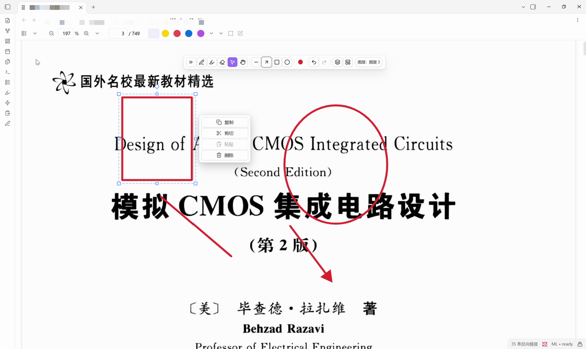
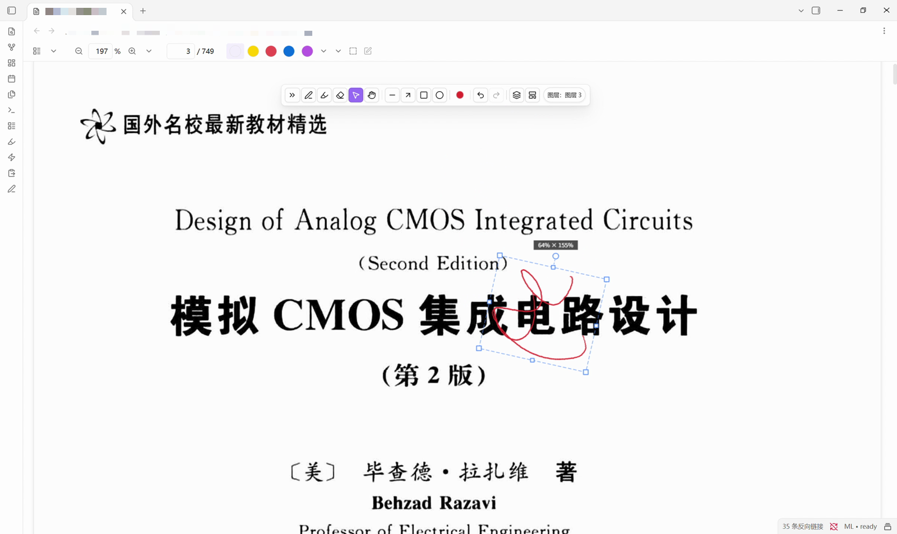

# Inkstone PDF

English | [中文](#中文说明)

Handwrite, sketch and annotate directly on PDF pages **inside Obsidian** — with pressure, layers,
undo/redo, and annotations stored separately so your PDF is never modified.

> **Inkstone PDF** (id `inkstone-pdf`) · desktop only · Obsidian 1.8.0+

> ### ⚠️ Early preview
>
> `0.1.2` is an **early preview, not a finished product.** The code is written by **DSH** (DeepSeek
> Harness). I test it, use it and pass the problems back. Expect rough edges.
>
> If something crashes, draws wrong, or simply does not do what you expect, **email
> `1315675831@qq.com`** with what you did and what happened instead. No template needed; a screenshot
> helps.
>
> Back up `附件/Ink 标注/` before you keep anything important in it.






## Why another PDF annotator?

Most PDF readers only highlight; handwriting lives on a tablet; and then you export screenshots and
retype your notes. Inkstone PDF closes that seam: the PDF view inside Obsidian becomes a page you can
write on, and the ink lives in your vault next to your notes.

- **Pen down, ink down.** No mode switch. Pressure is per point.
- **Boolean eraser.** Erasing carves ink away instead of painting over it, so erased parts never
  come back when you move the stroke.
- **Real selection.** Free X/Y scaling, single-axis handles, rotation with 15° snapping, arrow-key
  nudging, copy / cut / paste.
- **Document layers.** Annotate on one layer, answers on another, hide one to test yourself.
- **Screenless tablet support.** Hold a key for a temporary eraser, hold Shift and drag to resize
  the brush, rebindable keyboard shortcuts for every tool.
- **Your PDF stays untouched.** Strokes are stored in a sidecar JSON inside your vault, so they sync
  with it and undo still works.

## Install

> Preview build: back up `附件/Ink 标注/` before you annotate anything you care about.

### From the community directory

Settings → Community plugins → Browse → search **Inkstone PDF** → Install → Enable.

### Manually

1. Download `main.js`, `manifest.json` and `styles.css` from the latest release.
2. Put them in `<your vault>/.obsidian/plugins/inkstone-pdf/`.
3. Restart Obsidian (or press `Ctrl/Cmd+R`), then enable **Inkstone PDF** in
   Settings → Community plugins.

## Usage (the short version)

| Action | How |
| --- | --- |
| Write | Pick the pen and write on any PDF page |
| Tools | `P` pen · `H` highlighter · `E` eraser · `S` select · `L` line · `A` arrow · `R` rect · `O` ellipse · `G` pan |
| Brush panel | Double-click (or right-click / long-press) a brush button |
| Temporary eraser | Hold `F`, release to get the previous pen back |
| Resize the brush | Hold `Shift` and drag the pen **on the page**: left/right = size, up/down = opacity |
| Select ink | Select tool, drag a box; then drag, scale, rotate, or nudge with arrow keys |
| Text selection | Select tool + `Alt` (gives the page back to the PDF text layer) |
| Undo / redo | `Ctrl/Cmd+Z` · `Ctrl/Cmd+Shift+Z` |

Every shortcut above is rebindable in **Settings → Inkstone PDF → Key map**.

## Privacy & permissions

- **No network requests.** The plugin never phones home and has no telemetry.
- **Vault access** goes through the Obsidian API: it reads the PDF you opened and reads/writes its
  annotation file (`附件/Ink 标注/<path>.json`).
- **System clipboard: write-only, once.** The `Show performance summary` command copies the summary
  text to the clipboard so you can paste it into a bug report. The plugin never reads the clipboard.

## Feedback

A preview build lives or dies on bug reports, so they are the most useful thing you can send.

- **Email:** `1315675831@qq.com`
- Please include: your Obsidian version, the plugin version (Settings → Community plugins), what you
  did, and what happened instead.
- Useful extras: whether the PDF is a scan, how many pages it has, and whether it reproduces.
- Number to attach: command palette → `导出诊断信息` (export diagnostics) writes `debug.json` next to
  the plugin. It holds performance counters, the plugin list and the paths of open files — skim it
  before you attach it.

## Data

- Annotations: `<vault>/附件/Ink 标注/<path of the PDF>.json` (folder configurable).
- The PDF itself is never written to.
- Legacy eraser masks from very old builds are deleted on load (one `.bak` is written first); the
  ink those masks covered becomes visible again.

## Known limitations

- Desktop only; not tested on mobile.
- Rotated rectangles/ellipses are baked into polygons (visually identical, no longer a "shape").
- Annotations of a PDF live in the vault that contains that PDF.
- The annotation file only ever gains fields, so old data stays readable — but behaviour can still
  change between preview builds.

## What is still being built

Roughly the order it will be worked on. **None of it is a promise**; any item can move, shrink or
disappear.

**In progress**

- **Input smoothing.** An optional jitter filter (off / light / medium) for shaking hands. It costs
  0.5–2 frames of latency, so the default has to be measured on a real tablet instead of guessed.
- **Pan tool.** Hold `Shift` on the pan tool to zoom vertically, and a rebindable key that toggles
  between pen and pan.
- **More rebindable actions.** Eraser region/mode, brush presets 1–3, brush size ±, layer up/down,
  page next/previous. The key-map structure already exists; the actions are not wired up yet.
- **Brush panel finish.** Reorder presets, restore defaults, and keep the panel in step when the tool
  changes.

**Planned, shape not fixed**

- **Selection on big pages.** Dragging a selection repaints the whole page every frame; on a
  viewport-sized page that can drop frames.
- **Annotation file size.** A 749-page book with ~500 strokes comes to about 650 KB. Per-page files
  and stronger point quantisation are the candidates.
- **Wanted but undecided.** A highlighter that sits *over* existing ink, ink that works as an
  internal link between pages, stickers and pasted images.

**Not planned**

- Page-level layers, a zoom-in writing mode, a separate brush box, writing real PDF annotations back
  into the file, rich text.

## Development

```bash
npm install
npm run build          # tsc --noEmit + esbuild
npm test               # node --import tsx --test tests/*.test.ts
```

If the environment forbids spawning child processes (some sandboxes), bundle each test with esbuild
and run it with plain `node`; see `docs/handoff-*.md` for the exact commands used in this project.

```
src/                 TypeScript sources
tests/               unit tests + jsdom end-to-end
scripts/deploy.mjs   copy the build into <vault>/.obsidian/plugins/inkstone-pdf
main.js styles.css   build output (committed so any tag is installable)
```

## License

MIT — see [LICENSE](LICENSE). Bundled dependencies and their notices: [THIRD_PARTY_NOTICES.md](THIRD_PARTY_NOTICES.md).

---

## 中文说明

在 **Obsidian 里直接手写批注 PDF**：压感、图层、布尔裁剪橡皮、撤销/重做；笔迹存在库内的独立文件里，**原 PDF 一个字节都不改**。

> 插件名 **Inkstone PDF**（id `inkstone-pdf`），仅桌面端，Obsidian 1.8.0+。

> ### ⚠️ 先行测试版
>
> **`0.1.2` 是先行测试版，不是成品。** 代码由 **DSH**（DeepSeek Harness）开发，测试、实测和问题反馈由我来做，小毛病在所难免。
>
> 崩溃、笔迹画错、操作不符合预期——**发邮件到 `1315675831@qq.com`**，写清"做了什么 / 出现了什么现象"就行，不需要任何模板，有截图更好。
>
> 重要批注请先备份 `附件/Ink 标注/`。


### 解决什么问题

PDF 阅读器只能高亮，手写要去 iPad，写完还得导出、截图、手动誊回笔记——批注和笔记永远是两套东西。Inkstone PDF 把 Obsidian 的 PDF 视图变成一张可以直接写的纸，笔迹和你的笔记待在同一个库里。

- **落笔即写**，压感逐点生效，不需要先切"绘制模式"；
- **布尔裁剪橡皮**：擦过的地方是真的被挖掉，移动笔迹也不会重新冒出来；
- **有向选区**：四角自由缩放、边中点单轴缩放、圆点旋转（15° 吸附）、方向键微移、复制/剪切/粘贴；
- **文档级图层**：批注写一层、答案写一层，隐藏一层就能自己考自己；
- **数位板适配**：按住键临时橡皮、Shift 贴页面拖动改粗细、所有工具键位可重绑；
- **原 PDF 不动**：笔迹存在库内的侧车 JSON，跟随库同步，可撤销。

### 安装

> 先行测试版：正式拿来记东西之前，先备份 `附件/Ink 标注/`。

**社区目录**：设置 → 第三方插件 → 浏览 → 搜索 **Inkstone PDF** → 安装 → 启用。

**手动**：下载最新 Release 里的 `main.js`、`manifest.json`、`styles.css`，放到 `<你的库>/.obsidian/plugins/inkstone-pdf/`，重启 Obsidian（或 `Ctrl/Cmd+R`），再到 设置 → 第三方插件 启用。

### 用法速查

| 操作 | 方式 |
| --- | --- |
| 书写 | 选钢笔，直接在 PDF 页面上写 |
| 工具 | `P` 钢笔 · `H` 荧光笔 · `E` 橡皮 · `S` 选择 · `L` 直线 · `A` 箭头 · `R` 矩形 · `O` 椭圆 · `G` 拖拽页面 |
| 笔刷面板 | 双击（或右键/长按）笔刷按钮 |
| 临时橡皮 | 按住 `F`，松手回到原来那支笔 |
| 调笔刷 | 按住 `Shift`，让笔**贴着页面**移动：左右改粗细、上下改不透明度 |
| 选中笔迹 | 选择工具拖框；之后拖动、缩放、旋转、方向键微移 |
| 文本选择 | 选择工具 + `Alt`（把页面交还给 PDF 文本层） |
| 撤销/重做 | `Ctrl/Cmd+Z` · `Ctrl/Cmd+Shift+Z` |

以上键位都能在 **设置 → Inkstone PDF → 键位映射** 里改。

### 隐私与权限

- **不联网**：没有任何网络请求，也没有遥测。
- **库内读写**：通过 Obsidian API 读取你打开的 PDF，读写它的批注文件（`附件/Ink 标注/<路径>.json`）。
- **系统剪贴板：只写不读**，且只在一个地方写——「显示性能摘要」命令会把摘要文本复制到剪贴板，方便你贴进反馈里。插件从不读取剪贴板内容。

### 反馈

先行测试版最缺的就是问题报告，所以那是你能给出的最有用的东西。

- **邮箱**：`1315675831@qq.com`
- 请写上：Obsidian 版本、插件版本（设置 → 第三方插件）、你做了什么、实际发生了什么。
- 加分信息：PDF 是不是扫描件、多少页、能不能稳定复现。
- 想带上数据：命令面板 →「导出诊断信息」会在插件目录生成 `debug.json`，里面是性能计数、插件列表和打开文件的路径，发之前自己扫一眼。

### 数据

- 批注：`<库>/附件/Ink 标注/<PDF 路径>.json`（文件夹可改）。
- 不写入原 PDF。
- 更早版本的橡皮蒙版会在加载时被删除（先写一份 `.bak`），被它们盖住的墨迹会重新显示。

### 已知限制

- 仅桌面端，未在移动端测试。
- 旋转过的矩形/椭圆会被烘焙成多边形（外观一致，但不再是"形状"）。
- 同一个 PDF 的批注只存在于该 PDF 所在的那个库里。
- 批注文件只会增量加字段，旧数据始终可读——但测试版之间的行为仍可能变化。

### 后续在做什么

大致按动手顺序排，**都不是承诺**，任何一项都可能提前、推迟或砍掉。

**正在做**

- **输入抖动修正**：可选的抖动滤波（关 / 轻 / 中），照顾手不稳的情况；代价是 0.5–2 帧延迟，所以默认档要实测后再定，不拍脑袋。
- **拖拽工具收尾**：拖拽工具下按住 `Shift` 纵向缩放页面，外加一个可重绑的「笔 / 拖拽」切换键。
- **更多可重绑动作**：橡皮区域/方式、笔刷预设 1–3、笔宽 ±、图层上/下、翻页。键位表结构已就绪，动作还没接上。
- **笔刷面板收尾**：预设排序、恢复默认预设、切工具时面板跟着换。

**计划中，形态未定**

- **大页面上的选区变换**：拖动选区时每帧整页重绘，页面大时会掉帧。
- **批注文件体积**：749 页的书、约 500 笔就到 650KB 左右；候选方案是按页拆分 + 更强的点量化。
- **想加但没定**：能盖住已有墨迹的荧光笔、笔迹当页内链接跳转、贴纸与图片插入。

**明确不做**

页面级图层、放大书写模式、独立笔盒、写回 PDF 注释、富文本。

### 许可

MIT，见 [LICENSE](LICENSE)；打包的第三方代码与声明见 [THIRD_PARTY_NOTICES.md](THIRD_PARTY_NOTICES.md)。