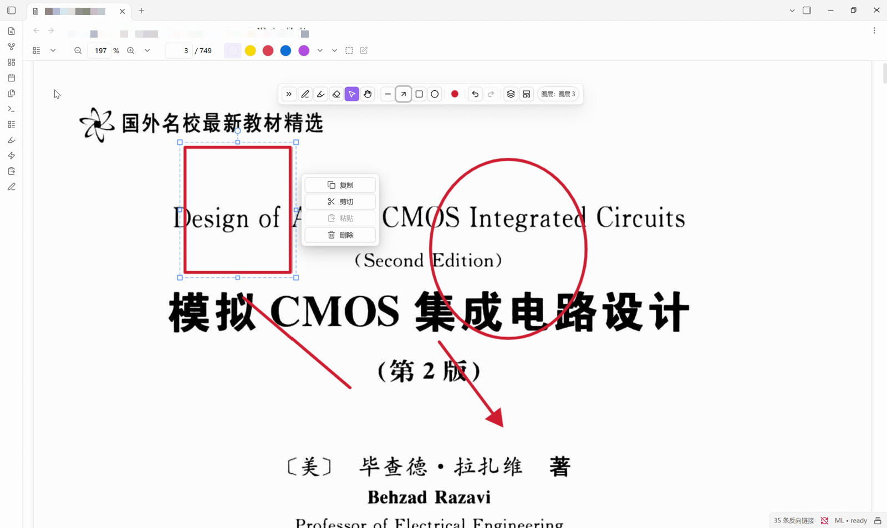
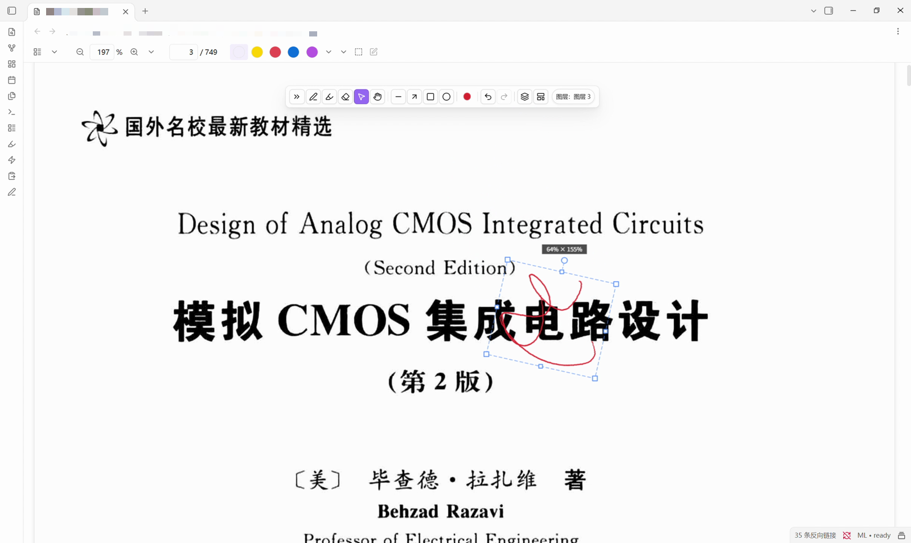
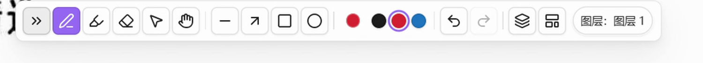

# Inkstone PDF

[English](#english) | [中文](#中文说明)

`inkstone-pdf` · desktop only · Obsidian 1.8.7+

## English

> **⚠️ Early preview (0.1.4).** The code is written by **DSH** (DeepSeek Harness); testing it, using
> it and reporting the problems back is my part. Plenty of rough edges are still open, but the core
> works, and reports from real use are what I need most right now.
>
> So far it has only been tested on **Windows with a pen tablet**. Send problems and suggestions to
> **`1315675831@qq.com`**. Back up `附件/Ink 标注/` before you trust it with notes that matter.







### What it does

In one sentence: it turns the PDF view inside Obsidian into a page you can write on. Pressure sets
the brush width, the eraser cuts a stroke apart instead of painting over it, ink can be rotated and
scaled, copied, cut and pasted; there are line, arrow, rectangle and ellipse tools, automatic shape
recognition, brush presets, a free colour picker, layers, rebindable shortcuts, a collapsible toolbar
with three layouts, a bilingual UI, pressure-triggered eraser and selection, and a per-tab switch that
turns a PDF back into a plain reader.

### Why I built it

While using Obsidian I could not find a mainstream PDF annotation plugin, so I decided to make one:
as rich in features as I could manage, with handwriting performance close to a dedicated notes app.
Development follows the feature set of **Xiangzuo Notes** (享做笔记); ideas from other apps will be
folded in as feedback arrives.

### Features

**Writing**

- **Pen down, ink down.** No drawing mode to switch into; pressure applies per point.
- **Three ink qualities.** Very fast / smooth / balanced (about 1.2 / 2.4 / 4 Mpx per page), so a
  749-page book stays usable on a laptop.
- **Input smoothing.** Optional One-Euro filter (off / light / medium) against hand tremor.
- **Pen or mouse.** Pens are freehand by default; the mouse can be made to draw as well, for tablets
  whose driver reports the pen as a mouse.

**Erasing**

- **Boolean eraser.** Erasing carves ink away instead of painting over it, so erased parts never come
  back when you move the stroke, and the gap you see is the gap you get after a reload.
- **Two modes, three regions.** Partial / whole-stroke, applied by free rubbing, rectangle or lasso.
- **Pressure gestures.** Hold the tip still: light pressure selects, heavy pressure erases. Both
  thresholds are adjustable, and can be turned off for pen tablets where they are hard to control.
- **Temporary eraser.** Hold a key (default `F`) and release to get the previous tool back.

**Selection and transform**

- **Oriented selection.** Free X/Y scaling from the corners, single-axis handles at the edge midpoints,
  rotation with 15° snapping, arrow-key nudging (10 px with `Shift`), copy / cut / paste, delete.
- **Mirroring.** Horizontal and vertical mirror in the selection menu for pen, highlighter, rectangles
  and ellipses (lines, arrows and polygons have no mirror axis).
- **Editable line/arrow endpoints.** Select a line or arrow and drag either end; the other end is
  pinned.

**Shapes**

- **Line, arrow, rectangle, ellipse**, plus automatic recognition: a clean straight line, box, circle,
  triangle or polygon becomes a standard shape after a short pause (350 ms by default, 150–1500 ms
  adjustable), or immediately if you prefer.

**Layers and tools**

- **Document layers.** Ink on one layer never affects another: annotate on one, answers on another,
  hide one to test yourself. Layers live in the sidebar panel, the popover, or the command palette.
- **Floating toolbar.** Tools, quick colours, undo/redo, layers and layout, collapsible and draggable,
  in horizontal, vertical or square layout.
- **Per-tab switch (0.1.4).** A pencil button in the PDF view header: lit means this tab is an
  annotation surface (toolbar up, ink writable); dark means it is a plain PDF reader — no ink is
  written, moved or erased and no shortcut is taken, while the ink already on the page stays visible.
  Each tab remembers its own state.
- **Hand tool.** `G` pans the page; hold `Shift` and drag sideways to zoom (ten speeds), up/down scrolls the page fast (5x by default, up to 10x). One drag does only one of the two — the first direction that moves decides.

**Keys, colours, data**

- **Pen tablet support.** Every tool has a rebindable shortcut, with a per-tool "tap / hold" choice;
  hold-keys give the tablet feel of "hold to erase, release to keep writing".
- **Brush presets and palettes.** Presets are colour + width + opacity; the toolbar keeps up to six
  quick colours, a full palette and a free colour picker with hex input.
- **Your PDF is never modified.** Ink is stored in a sidecar JSON inside the vault, syncs with the
  vault, and undo still works.
- **Bilingual UI.** Auto / 中文 / English; command names, toolbar, brush panel and settings follow.

### Install

> Preview build: back up `附件/Ink 标注/` before you annotate anything you care about.

**From the community directory:** Settings → Community plugins → Browse → search
**Inkstone PDF** → Install → Enable.

**Manually:** download `main.js`, `manifest.json` and `styles.css` from the latest release, put them
in `<your vault>/.obsidian/plugins/inkstone-pdf/` (create the folder if it does not exist), restart
Obsidian (or press `Ctrl/Cmd+R`), then enable **Inkstone PDF** under Settings → Community plugins.

### Usage

| Action | How |
| --- | --- |
| Write | Pick the pen and write on any PDF page |
| Default shortcuts | `P` pen · `H` highlighter · `E` eraser · `S` select · `L` line · `A` arrow · `R` rectangle · `O` ellipse · `G` hand tool |
| Turn annotation off for one tab | Click the pencil button in the PDF's header — the tab becomes a plain reader, the existing ink stays visible |
| Brush panel | Double-click (or right-click / long-press) a brush button |
| Temporary eraser | Hold `F`, release to get the previous tool back |
| Adjust the brush | Hold `Shift` and move the pen **on the page**: left/right = size, up/down = opacity |
| Select ink | Drag a box with the select tool; then drag, scale, rotate, or nudge with the arrow keys |
| Copy / cut / paste | `Ctrl/Cmd+C` · `X` · `V`; `Delete` removes the selection |
| Text selection | Select tool + `Alt` (hands the page back to the PDF text layer) |
| Undo / redo | `Ctrl/Cmd+Z` · `Ctrl/Cmd+Shift+Z` |
| Layers | Toolbar layer button, the sidebar panel, or the command palette |

Every shortcut above is rebindable in **Settings → Inkstone PDF → Key bindings**.

### Settings worth knowing

- **Interface language** — Auto / 中文 / English.
- **Annotation folder** — where the sidecar JSON files go.
- **Input device** — touch-screen tablet vs pen tablet: the pen-tablet preset disables the
  invisible gestures and turns on the side-button temporary eraser.
- **Ink quality / smoothness** — the pixel budget per page.
- **Input smoothing**, **Shift + hover sensitivity**, **low-latency canvas (experimental)**,
  **blur shield** for other plugins' frosted backgrounds.
- **Always show toolbar**, **toolbar layout**, **hand-tool zoom speed**.
- **Key bindings** — every action, plus tap/hold mode per tool.
- **Pen, highlighter, eraser defaults** — colour, width, opacity; eraser mode, region and radius.
- **Pressure gestures** — hold time, pressure window, still radius, erase pressure, disc follows
  pressure.
- **Shape recognition** — on/off, trigger (pause or immediate), pause length.
- **Quick colours, palette, brush presets.**

### Privacy & permissions

- **No network requests.** The plugin never phones home and has no telemetry.
- **Vault access** goes through the Obsidian API: it reads the PDF you opened and reads/writes its
  annotation file (`附件/Ink 标注/<path>.json`).
- **System clipboard: write-only.** Only the `Show performance summary` command writes to it, so you
  can paste the summary into a report. The plugin never reads the clipboard.

### Feedback

A preview build depends on problem reports and suggestions more than anything else, so send them
along; I will adopt what fits.

- **Email:** `1315675831@qq.com`
- Please include: your Obsidian version, the plugin version (Settings → Community plugins), what you
  did, and what actually happened. The more detail, the better.
- Optional data: command palette → `Export diagnostics` writes `debug.json` into the plugin folder.
  Attach it if you can.

### Data

- Annotations: `<vault>/附件/Ink 标注/<path of the PDF>.json` (the folder is configurable).
- The PDF itself is never written to.
- Legacy eraser masks from very old builds are deleted on load (one `.bak` is written first); the ink
  those masks covered becomes visible again.

### Known limitations

- Tested on desktop, on Windows only; other systems and devices are untested.
- A rotated rectangle or ellipse becomes a polygon — visually identical, but no longer an editable
  "shape".
- Shape tools have no separate selection mode after drawing: a line or arrow can have its endpoints
  dragged, but rectangles and ellipses cannot be picked up and edited the way ink can.
- A PDF's annotations live in the vault that contains that PDF.
- The annotation file only ever gains fields, so old data stays readable — but behaviour can still
  change between preview builds.

### What is still being built

Roughly the order things will be worked on. **None of it is a promise**: any item can move forward,
slip, or be dropped.

**In progress**

- **Hand tool finish.** A rebindable key that toggles between pen and pan.
- **More rebindable actions.** Eraser shape/mode, brush presets 1–3, brush size ±, layer up/down,
  page next/previous and more.
- **Brush panel finish.** Reorder presets, restore the defaults, and keep the panel in step when the
  tool changes.

**Planned, shape not fixed**

- **Selection on big pages.** Dragging a selection repaints the whole page every frame, which can
  drop frames on a large page.
- **Annotation file size.** A 749-page book with about 500 strokes reaches roughly 650 KB; per-page
  files and stronger point quantisation are the candidates.
- **Re-editing shapes.** Picking up a drawn rectangle or ellipse and reshaping it after the fact.
- **Wanted but undecided.** A highlighter that covers existing ink, ink that acts as an internal link
  between pages, stickers and pasted images.

### Development

```bash
npm install
npm run build          # tsc --noEmit + esbuild
npm test               # node --import tsx --test tests/*.test.ts
```

If the environment forbids spawning child processes (some sandboxes), bundle each test with esbuild
and run it with plain `node`.

```
src/                 TypeScript sources
tests/               unit tests + jsdom end-to-end
scripts/deploy.mjs   copy the build into <vault>/.obsidian/plugins/inkstone-pdf
main.js styles.css   build output (committed so any tag is installable)
```

### License

MIT — see [LICENSE](LICENSE). Bundled dependencies and their notices:
[THIRD_PARTY_NOTICES.md](THIRD_PARTY_NOTICES.md).

---

## 中文说明

`inkstone-pdf` · 仅桌面端 · 需要 Obsidian 1.8.7 及以上

> **⚠️ 先行测试版（0.1.4）** —— 代码由 **DSH**（DeepSeek Harness）开发，测试、实测和问题反馈由我来做。目前还有不少问题没解决，但核心功能已经基本完成，现在最需要的就是真实使用中的反馈。
>
> 目前只在 **Windows + 数位板** 环境实测过。发现问题请发邮件到 **`1315675831@qq.com`**。重要批注请先备份 `附件/Ink 标注/`。


### 这个插件做什么

简单来说就是，把 Obsidian 的 PDF 视图变成一张可以手写的纸。压感控制笔刷粗细；橡皮按笔迹部分擦除；笔迹可以旋转、缩放、复制、剪切、粘贴；有直线、箭头、矩形、椭圆四种图形工具和自动图形识别；支持笔刷预设与自由取色、图层、快捷键自行绑定、工具栏收起与三种布局、中英双语界面、压感触发橡皮与选择工具，还有一个按标签页切换的开关，关掉就把 PDF 变回普通阅读器。

### 开发原因

使用 Obsidian 的过程中，我发现没有主流的 PDF 批注插件，于是决定自己做一个：功能尽量丰富，书写性能尽量接近手写笔记软件。开发时主要对齐 **享做笔记** 的功能，后续会根据反馈吸收其他软件的优点。

### 功能详解

**书写**

- **落笔即写**：不需要先切「绘制模式」，压感逐点生效。
- **三档墨迹清晰度**：极流畅 / 流畅优先 / 平衡（约每页 1.2 / 2.4 / 4 Mpx），749 页的书在笔记本上也还撑得住。
- **输入抖动修正**：关 / 轻 / 中三档 One-Euro 滤波，抑制手抖。
- **笔和鼠标**：默认数位笔直接书写；如果手写板驱动把笔上报成鼠标，可以打开「鼠标也直接书写」兜底。

**擦除**

- **布尔裁剪橡皮**：擦除精度到像素级，屏幕上看到的空白就是重新打开后的空白，不会出现和视觉不一致的擦除痕迹。
- **两种方式、三种区域**：涂抹（只擦选中部分）/ 整笔（碰到就整条删），用自由涂抹、矩形框选或套索框选来擦。
- **压感手势**：笔尖停住不动——轻压选中、重压擦除；阈值都能调，数位板上不好控制时可以整体关掉。
- **临时橡皮**：按住 `F` 临时变橡皮，松开回到原来那支笔。

**选择与变换**

- **有向选区**：四角自由缩放、边中点单轴缩放、圆点旋转（15° 吸附）、方向键微移（`Shift` 10px）、复制 / 剪切 / 粘贴 / 删除。
- **镜像**：选中菜单里水平、垂直镜像，适用于钢笔、荧光笔、矩形、椭圆（直线、箭头、多边形没有镜像轴）。
- **可改端点**：选中直线或箭头后拖动任意一端，另一端钉住不动。

**图形**

- **直线、箭头、矩形、椭圆**，外加自动识别：干净的长直线、方框、圆、三角或多边形，画完稍作停顿就替换成标准图形（默认 350ms，可调 150–1500ms），也可以选「画完立即识别」。

**图层与工具**

- **文档级图层**：不同图层之间的笔迹互不影响；可以在一个图层批注、另一个图层写答案，也能隐藏一层自测。图层在侧边栏面板、工具栏弹层和命令面板里都能操作。
- **浮动工具栏**：工具、常用色、撤销/重做、图层、布局切换，可收起、可拖动，横向 / 纵向 / 方形三种布局。
- **按标签页的开关（0.1.4）**：PDF 顶部栏有一个铅笔按钮。亮＝这个标签页是批注面（工具栏显示、可以落笔）；灭＝回到普通 PDF 阅读器（不落笔、不移动或擦除笔迹、不抢快捷键），但**已经画好的批注照样显示**。每个标签页各记各的。
- **拖拽工具**：`G` 平移页面；按住 `Shift` 左右拖动缩放（十档速度），上下拖动快速翻页（默认 5 倍，最高 10 倍）。一次拖动只会进入其中一种，按第一次移动的方向决定。

**键位、颜色、数据**

- **数位板适配**：所有工具都能自行绑定快捷键，每个工具还能选「点按 / 按住」——按住式才有「按住擦、松手继续写」的手感。
- **笔刷预设与调色板**：预设是「颜色 + 粗细 + 不透明度」的整套组合；工具栏保留最多 6 个常用色，外加完整调色板与带 hex 输入的自由取色器。
- **原 PDF 不动**：笔迹存在库内的侧车 JSON，跟随库同步，可撤销。
- **中英双语界面**：自动 / 中文 / English，命令名、工具栏、笔刷面板、设置项全部跟随。

### 安装

> 先行测试版：正式拿来记东西之前，先备份 `附件/Ink 标注/`。

**社区目录**：设置 → 第三方插件 → 浏览 → 搜索 **Inkstone PDF** → 安装 → 启用。

**手动安装**：下载最新 Release 里的 `main.js`、`manifest.json`、`styles.css`，放到 `<你的库>/.obsidian/plugins/inkstone-pdf/`（没有就自己建一个），重启 Obsidian（或 `Ctrl/Cmd+R`），再到 设置 → 第三方插件 启用。

### 用法速查

| 操作 | 方式 |
| --- | --- |
| 书写 | 选钢笔，直接在 PDF 页面上写 |
| 默认快捷键 | `P` 钢笔 · `H` 荧光笔 · `E` 橡皮 · `S` 选择 · `L` 直线 · `A` 箭头 · `R` 矩形 · `O` 椭圆 · `G` 拖拽页面 |
| 单个标签页关掉批注 | 点 PDF 顶部栏的铅笔按钮——这个标签页变回普通阅读器，已画批注仍然显示 |
| 笔刷面板 | 双击（或右键/长按）笔刷按钮 |
| 临时橡皮 | 按住 `F`，松开回到原来工具 |
| 调笔刷 | 按住 `Shift`，让笔**在页面上划动**：左右改粗细、上下改不透明度 |
| 选中笔迹 | 选择工具拖框；之后拖动、缩放、旋转、方向键微移 |
| 复制 / 剪切 / 粘贴 | `Ctrl/Cmd+C` · `X` · `V`；`Delete` 删掉选中 |
| 文本选择 | 选择工具 + `Alt`（把页面交还给 PDF 文本层） |
| 撤销/重做 | `Ctrl/Cmd+Z` · `Ctrl/Cmd+Shift+Z` |
| 图层 | 工具栏图层按钮、侧边栏面板或命令面板 |

以上键位都能在 **设置 → Inkstone PDF → 键位映射** 里改。

### 值得注意的设置项

- **界面语言**：自动 / 中文 / English。
- **批注数据文件夹**：侧车 JSON 存哪儿。
- **输入设备**：触屏平板 / 数位板。选数位板会关掉看不见的手势并启用侧键临时橡皮。
- **墨迹清晰度 / 流畅度**：每页的像素预算。
- **输入抖动修正**、**Shift + 悬停灵敏度**、**低延迟画布（实验）**、**关闭其他插件的毛玻璃背景**。
- **始终显示工具栏**、**工具栏布局**、**拖拽工具下 Shift 缩放 / 翻页的灵敏度**。
- **键位映射**：每个动作，外加每个工具的「点按 / 按住」。
- **钢笔、荧光笔、橡皮的默认值**：颜色、粗细、不透明度；橡皮的方式、区域与半径。
- **手势**：按住时间、压力判定窗口、静止判定半径、擦除触发压力、擦头随压力变化。
- **自动识别图形**：开 / 关、触发方式（停顿 / 立即）、停顿时间。
- **常用色、调色板、笔刷预设。**

### 隐私与权限

- **不联网**：没有任何网络请求，也没有遥测。
- **库内读写**：通过 Obsidian API 读取你打开的 PDF，读写它的批注文件（`附件/Ink 标注/<路径>.json`）。
- **系统剪贴板：只写不读**，且只在一个地方写——「显示性能摘要」命令会把摘要文本复制到剪贴板，方便你贴进反馈里。插件从不读取剪贴板内容。

### 反馈

先行测试版最缺的就是问题报告和建议，欢迎大家邮件给我，我会按情况采纳。

- **邮箱**：`1315675831@qq.com`
- 请写上：Obsidian 版本、插件版本（设置 → 第三方插件）、你做了什么、实际发生了什么，越详细越好。
- 可选数据：命令面板 →「导出诊断信息」会在插件目录生成 `debug.json`，能附上就一并附上。

### 数据

- 批注：`<库>/附件/Ink 标注/<PDF 路径>.json`（文件夹可改）。
- 不写入原 PDF。
- 很旧的版本留下的擦除遮罩会在加载时清除（先写一份 `.bak`），被遮住的笔迹会重新显示出来。

### 已知限制

- 仅在桌面端 Windows 系统测试过，其他系统和设备均未测试。
- 旋转过的矩形、椭圆会被固化成多边形：看起来一样，但不再是可编辑的「图形」。
- 图形工具绘制后没有独立的选中修改模式：直线和箭头能拖端点，矩形和椭圆则不能像笔迹那样选中后调整。
- 同一个 PDF 的批注只存在于该 PDF 所在的那个库里。
- 批注文件只会增量加字段，旧数据始终可读——但测试版之间的行为仍可能变化。

### 后续在做什么

大致按动手顺序排，**未必一定实现**：任何一项都可能提前、推迟或砍掉。

**正在做**

- **拖拽工具收尾**：加一个可重绑的「笔 / 拖拽」切换键。
- **更多可重绑动作**：橡皮区域/方式、笔刷预设 1–3、笔宽 ±、图层上/下、翻页等。
- **笔刷面板收尾**：预设排序、恢复默认预设、切工具时面板跟着换。

**计划中，形态未定**

- **大页面上的选区变换**：拖动选区时每帧整页重绘，页面大时会掉帧。
- **批注文件体积**：749 页的书、约 500 笔就到 650KB 左右；候选方案是按页拆分 + 更强的点量化。
- **图形再编辑**：画好的矩形、椭圆能重新选中并改形状。
- **想加但没定**：能盖住已有墨迹的荧光笔、笔迹当页内链接跳转、贴纸与图片插入。

### 开发

```bash
npm install
npm run build          # tsc --noEmit + esbuild
npm test               # node --import tsx --test tests/*.test.ts
```

若环境不允许启动子进程（某些沙箱），就用 esbuild 单独打包每个测试，再用 `node` 跑。

```
src/                 TypeScript 源码
tests/               单元测试 + jsdom 端到端
scripts/deploy.mjs   把构建产物复制到 <库>/.obsidian/plugins/inkstone-pdf
main.js styles.css   构建产物（一并提交，保证任何 tag 都能安装）
```

### 许可

MIT，见 [LICENSE](LICENSE)；打包的第三方代码与声明见 [THIRD_PARTY_NOTICES.md](THIRD_PARTY_NOTICES.md)。
